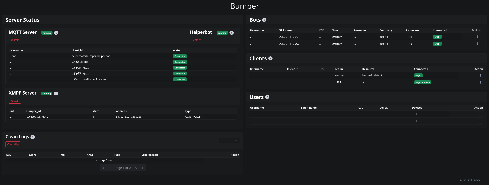

# Bumper


[](https://github.com/MVladislav/bumper/actions/workflows/ci.yml)
[](https://github.com/MVladislav/bumper/actions/workflows/codeql-analysis.yml)
[](https://codecov.io/gh/MVladislav/bumper)
[](https://results.pre-commit.ci/latest/github/MVladislav/bumper/dev)
[](https://github.com/MVladislav/bumper/actions/workflows/docker-release.yml)
[](https://github.com/MVladislav/bumper/actions/workflows/release-drafter.yml)

> **Bumper** is a self-hosted central server for Ecovacs robots, including DEEBOT vacuums and GOAT mowers.
> It replaces the Ecovacs cloud, giving you full local control through a privacy-first,
> high-performance stack: Python + uv, Docker Swarm, and NGINX.



## 🔑 Key Features

- **Self-Hosted**: Operate without Ecovacs cloud servers.
- **Privacy-First**: All data stays within your network.
- **High Performance**: Built on Python 3.13+ with [uv](https://pypi.org/project/uv/) for efficient async I/O.
- **Docker Swarm & Compose**: One-command startup with turnkey NGINX configuration.
- **Modular**: Easily extend protocols and add integrations.

> **⚠️ Warning**: Branches `main`/`dev` are under active development and may be unstable. Use at your own risk.

---

## 🚀 Quickstart

### 🔧 Prerequisites

**TLS certificates**:

[Certificates](https://mvladislav.github.io/bumper/getting_started/certificates/).

**Environment variables**:

Create a `.env` file with at least the following:

```env
# 'overlay' for Docker Swarm, 'bridge' for plain Docker Compose
NETWORK_MODE=overlay

# required by the Compose file
BUMPER_ANNOUNCE_IP=192.168.0.100  # your server's local IP
```

Full configuration options are available in the
[Environment Variables](https://mvladislav.github.io/bumper/configuration/environment/).

### ✨ Docker Swarm Deployment

**Step 1 - Clone the repository**

```sh
git clone https://github.com/MVladislav/bumper.git
cd bumper
```

**Step 2 - Initiate Docker in Swarm mode**

```sh
docker swarm init
```

**Step 3 - Start services**

```sh
# Docker Swarm: pulls ghcr.io/mvladislav/bumper (tag from VERSION_BUMPER, default "latest")
docker-swarm-compose deebot

# or plain Docker Compose: builds the image from this checkout
docker compose up -d
```

**Step 4 - Open the UI**

Visit `https://ecovacs.net/` in your browser.

---

## 📖 Documentation

In-depth guides and architecture details are available in the `docs/` folder or online:

- **Online**: [Documentation](https://mvladislav.github.io/bumper/)
- **Getting started**: [DNS Setup](https://mvladislav.github.io/bumper/getting_started/dns/) and [Certificates](https://mvladislav.github.io/bumper/getting_started/certificates/)
- **Docker Usage**: [Docker](https://mvladislav.github.io/bumper/usage/docker/)
- **Mobile App**: [Mobile App Integration](https://mvladislav.github.io/bumper/usage/mobile_app/)
- **Environment Variables**: [Configuration](https://mvladislav.github.io/bumper/configuration/environment/)
- **How It Works**: [Architecture](https://mvladislav.github.io/bumper/internals/architecture/)

---

## 🔄 Compatibility

### 🤖 Supported Robots

See [Model Compatibility](https://mvladislav.github.io/bumper/reference/models/) for reported working models, known limitations, and cases that still need verification.

### 📱 Supported Apps

The official Ecovacs app works with Bumper once it is patched, and the patch is not
tied to an app version anymore - there is no version table to keep. See
[Mobile App Integration](https://mvladislav.github.io/bumper/usage/mobile_app/) and
[Certificate Pinning Bypass (APP)](https://mvladislav.github.io/bumper/internals/certificate-unpinning-app/).

---

## 👥 Community

Join our Gitter channel to discuss features, report issues, and share setups:

[](https://gitter.im/ecovacs-bumper/community)

Or use the GitHub Discussions section for longer conversations and proposals.

---

## 🤝 Contributing

Contributions are welcome! To get started:

1. Fork the repo and create a feature branch.
2. Run tests and linters:
   ```sh
   uv run --active pytest tests
   uv run --active --frozen ruff check bumper/
   uv run --active --frozen ruff format --check bumper/
   uv run --active --frozen mypy bumper/
   uv run --active --frozen pylint bumper/
   ```
3. Submit a pull request against `main`.

See the [Development Guide](https://mvladislav.github.io/bumper/development/dev-guide/) for the full setup.

---

## 🧪 Testing Needed

Bumper relies on community testing for broader device coverage. If you test Bumper
with your robot, please open a [discussion](https://github.com/MVladislav/bumper/discussions) with:

- `classid` and `model` (from the app, or match the name in `bumper/web/static_api/productIotMap.json`)
- Firmware version
- Protocol used (MQTT / XMPP / NGIoT)
- Whether the app works, or only a client such as `deebot-client`
- Success or failure details, with `DEBUG_BUMPER_LEVEL=DEBUG` logs

The confirmed models are tracked on the
[Model Compatibility](https://mvladislav.github.io/bumper/reference/models/) page.

---

## 📜 License

Released under the [GPLv3 License](LICENSE).

---

## 🗂 References

- <https://github.com/bmartin5692/bumper>
- <https://github.com/edenhaus/bumper>
- <https://github.com/Yakifo/amqtt>
  - <https://github.com/MVladislav/amqtt>
- <https://github.com/DeebotUniverse/client.py>

---

## 🙏 Thanks

Special thanks to:

- **@torbjornaxelsson** for the original Bumper implementation.
- **@wpietri** and contributors of [Sucks](https://github.com/wpietri/sucks) for the open‑source Ecovacs client.
- All community members who test and contribute to making Bumper better.

_Originally forked from [edenhaus/bumper](https://github.com/edenhaus/bumper) (via [bmartin5692](https://github.com/bmartin5692/bumper)) · Maintained by @MVladislav_
