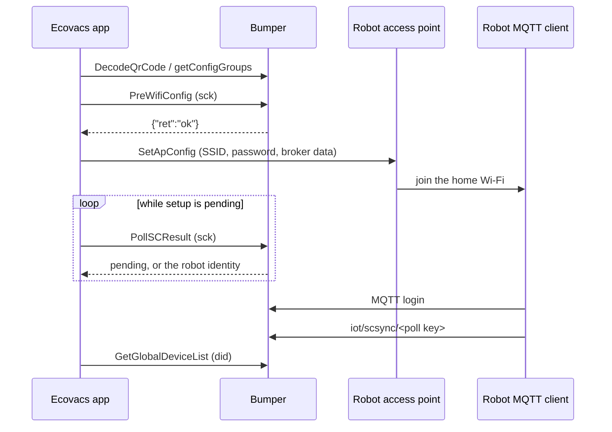

# Robot Wi-Fi Onboarding

Bumper answers the server side of the official app's Wi-Fi setup for MQTT
robots. The phone still talks to the robot's setup access point; Bumper does
not configure the robot's Wi-Fi. Bumper starts the setup, waits for the robot to
connect, and then returns the robot identity to the app.

## Flow

## How Bumper completes a setup

1. `PreWifiConfig*` opens one in-memory setup slot for the app user. The slot
   lives for 30 minutes.
2. While the robot has not connected, `PollSCResult` answers the pending shape
   from the official server: `ret: fail`, `errno: 600`, `subCode: 1`. Bumper
   adds a short `debug` hint, which the app ignores.
3. A robot authenticates to Bumper's MQTT broker and publishes
   `iot/scsync/<key>`. The setup completes only when that key matches the key
   of the latest poll from the same app user.
4. The next poll answers with the robot identity:
   `{"ret":"ok","did":…,"type":…,"resource":…,"name":…}`.
5. The MQTT login already created the bot record, so `GetGlobalDeviceList`
   returns the new bot. When the request carries a `did`, Bumper returns only
   that device, which is what the app asks for after setup.

The `sck` sent with `PreWifiConfig` and the `sck` sent with `PollSCResult` can
differ. The app user is the stable link between the two calls, so Bumper does
not require the keys to be equal.

After success the app also calls `homed/device/move`, `device/blacklist/check`,
`member/getBindBenefit`, and `users/user.do` with `todo: SetDeviceNick`. Bumper
already answers those; `device/move` is a no-op because Bumper reports every
device in its default home.

## What Bumper does not do

- It does not implement the robot's local setup endpoint
  (`http://192.168.0.1:8888/rcp.do`, `SetApConfig`). The phone must reach the
  robot's access point and send the Wi-Fi credentials itself.
- It does not create a DID, password, class, or resource for a factory-fresh
  robot. The robot must already have usable credentials.
- It does not change the robot's certificate trust. Some firmware, including
  the analyzed T10, trusts an embedded Ecovacs CA and will not accept Bumper's
  generated certificate without a device-side change.
- It supports one setup at a time. A second `PreWifiConfig` replaces the active
  slot.

## Requirements for a working setup

1. The app and the robot must reach Bumper's web and MQTT services.
2. The robot must trust Bumper's TLS certificate and authenticate with
   credentials Bumper accepts.
3. The robot's class must exist in Bumper's product map, so the device list can
   describe it.
4. The phone must be able to complete the local AP handoff; Bumper cannot do
   that part.

## Verifying a setup

A successful run looks like this in the Bumper log:

1. `PreWifiConfig` returns `ok`.
2. The first `PollSCResult` returns the pending shape.
3. The robot authenticates over MQTT.
4. The robot publishes `iot/scsync/<poll key>`.
5. The next `PollSCResult` returns the robot identity.
6. `GetGlobalDeviceList` with the new `did` returns one device, and the app
   opens that robot.

If the poll stays pending, check the robot's MQTT login, its `iot/scsync`
publish, the app user on both setup calls, and whether the class is present in
the product map. A phone-to-robot AP failure happens before Bumper is involved;
Bumper cannot see or repair it.
