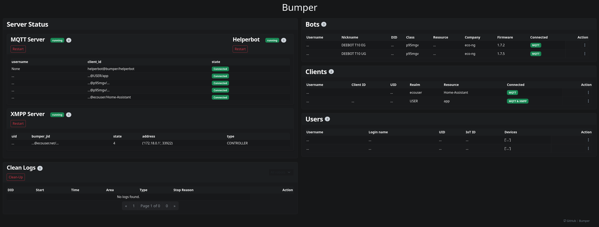

# 🚀 Getting Started

This guide walks through a complete Bumper setup: DNS, certificates, deployment, and connecting the app and robots.
Bumper only works when **every part of the path** points at it - DNS, TLS trust, and the Bumper services.

!!! note

    **Bumper does not replace the Ecovacs cloud for every feature.**
    It reimplements the parts needed for local control. Some cloud-only features are not available.

---

## 📋 Before you start

You need:

- A server on your local network that can run Bumper (Docker is the recommended deployment).
- A DNS server you control (Pi-hole, OPNsense/Unbound, dnsmasq, router DNS, etc.)
  that can override Ecovacs domains to your Bumper server.
- A robot and/or client that can reach Bumper:
    - a robot already configured on your network,
      once its traffic is redirected to Bumper and it trusts Bumper's certificate; or
    - the official Ecovacs/Ecovacs Home app, configured to trust Bumper's CA and use your DNS; or
    - [DeebotUniverse/client.py](https://github.com/DeebotUniverse/client.py).

Check [Model Compatibility](../reference/models.md) for known reports and limitations.
A missing model has not been reported; it may still work, but protocol and certificate behavior are model-dependent.

---

## ✅ Setup checklist

Follow these steps in order:

1. **[DNS Setup](dns.md)** - override Ecovacs domains so the app and robot resolve them to your Bumper server.
2. **[Certificates](certificates.md)** - create TLS certificates before you use
   the checked-in Compose/Swarm files, which load `$PWD/certs` read-only:
   `bash scripts/certs/create-cert.sh` (add `--rsa` if your robot needs RSA).
3. **[Deploy Bumper](../usage/docker.md)** - run Bumper with Docker/Compose (recommended, usually behind nginx or Traefik).
   Set `BUMPER_ANNOUNCE_IP` to the server's LAN IP.
4. **[Connect the Official App](../usage/mobile_app.md)** - install Bumper's CA on the phone and log in to the app.
5. **[Robot Wi-Fi Setup](robot-onboarding.md)** - only if you need the app's Wi-Fi onboarding flow through Bumper.
   The server-side flow is handled by Bumper; the phone still configures the robot over the robot's setup access point.

---

## 👀 What to expect

### The web UI

Bumper's web UI (for example `https://ecovacs.net/` when DNS points that name to Bumper) is a **status and debug view**.
It shows information about connected clients and bots.
It is not the place where you manually "add" a vacuum.

Seeing only **helperbot** is normal when no robot or app client is currently connected to Bumper.

### When a robot appears

A robot appears after it successfully connects to Bumper's MQTT/XMPP/web services and is identified by Bumper.
That requires:

- **DNS/routing** sends the robot's Ecovacs domains to Bumper.
- **Reachability** through the ports and hostnames your deployment exposes.
  Bumper listens for HTTPS, HTTP, MQTT, MQTTS, and XMPP TLS; the defaults and
  their overrides are in [Services](../internals/architecture.md#services) and
  [Environment Variables](../configuration/environment.md).
  In the recommended Docker + reverse proxy setup (nginx/Traefik),
  clients usually reach Bumper through the proxy.
  The proxy can route TLS on port `443` by SNI/hostname:
  for example, `mq*` hostnames to MQTTS and Ecovacs/Ecouser web hostnames to HTTPS,
  as configured in the provided nginx/Traefik examples.
  Some robots/apps may connect to native protocol ports directly when those ports are exposed.
  See [Docker](../usage/docker.md) and the nginx/Traefik compose examples.
- **Certificate trust** for the path the robot uses.
  Some models/apps need extra steps; see [Model Compatibility](../reference/models.md)
  and the certificate unpinning guides
  ([APP](../internals/certificate-unpinning-app.md),
  [BOT](../internals/certificate-unpinning-bot.md)).
- **Robot configuration**: the robot must already be talking to those domains,
  or you must complete the onboarding flow.

If the app can reach Bumper but no robot appears,
check Bumper logs, DNS resolution from the robot's network, certificate trust, and model-specific requirements.

### The official app

The official app is optional for some setups (for example, command-line/control clients),
but it is the usual way to verify connectivity and run onboarding flows.
App behavior depends on app version, region, and model.
Push notifications and other cloud-only features may not work.

---

## 🛠️ Troubleshooting

- **`ecovacs.net` shows only helperbot / robot not appearing**: work through the checklist under
  [When a robot appears](#when-a-robot-appears) - DNS, reachability, certificate trust, and robot
  configuration, in that order. Confirm each step from the robot's network, not from the server.
- **Certificates missing or not trusted**: the checked-in Compose/Swarm files
  load `$PWD/certs/*` read-only, so the files must exist before deployment. See
  [Certificates](certificates.md) for creating and installing them.
- **DNS not taking effect**: test with `dig`/`nslookup` against the DNS server your device uses;
  clear caches or reboot the device/robot. See [DNS Setup](dns.md).
- **TLS/certificate errors**: confirm the certificate matches the domains in use and that the
  client trusts the CA on the path it uses. App-side pinning and native TLS stacks may need
  [Certificate Pinning Bypass (APP)](../internals/certificate-unpinning-app.md) or model-specific steps.
- **Need more detail**: enable debug logging with [Environment Variables](../configuration/environment.md)
  and inspect container/server logs.

For user reports and questions, see [Discussions](https://github.com/MVladislav/bumper/discussions).
