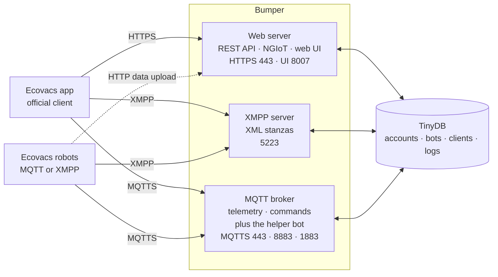

# How It Works

!!! warning "Disclaimer"

    This document is a work in progress and may contain inaccuracies or incomplete sections.
    Some parts serve as placeholders and require further refinement.
    Please refer to the source code for authoritative information, and feel free to submit corrections or improvements.

Bumper recreates Ecovacs's cloud services locally, so supported robots and apps can work inside your network.
The app uses the web API for discovery, accounts, and Wi-Fi onboarding. For live traffic it uses **XMPP** with older
robots and **MQTT** with newer ones, and a robot speaks exactly one of the two. Robots authenticate and exchange
onboarding messages over their live protocol. Supported robots also POST data to the web API over HTTPS.

The app and the robot reach Bumper over TLS. The app connects to `mq*.ecouser.net` on port `443`, and to the
web hosts on `443` as well, so the shipped nginx/Traefik listener reads the SNI: an `mq*` host goes to the
MQTT broker, every other Ecovacs host goes to the web server. XMPP keeps its own port `5223`. The app
provisions a robot with the same `443` broker endpoint; Bumper also listens on `8883` for robots configured
with that port.

The app and the robot never talk to each other directly. XMPP stanzas are relayed by Bumper; MQTT telemetry
is routed by the broker, and a REST command reaches the robot through the helper bot inside the broker.

---

## 🧩 Services

| Service     | Description                                           | Ports      | Module Path          |
| ----------- | ----------------------------------------------------- | ---------- | -------------------- |
| Web Server  | Handles discovery, login, REST API, and robot uploads | 443, 8007  | `bumper.web.server`  |
| XMPP Server | Relays XML stanzas between client and robot over XMPP | 5223       | `bumper.xmpp.xmpp`   |
| MQTT Broker | Manages MQTT topics for telemetry and commands        | 8883, 1883 | `bumper.mqtt.server` |

---

## 🔐 Account and Authentication

Bumper recreates the account and token plumbing the app expects, but it does not verify Ecovacs request signatures. The
app logs in with an account name, receives an opaque access token, exchanges an IoT token for an auth code, and then
receives OAuth tokens. The same auth code links the account to the XMPP or MQTT transport.

The account key is separate from the TLS key. The private half stays in the data directory, so Bumper can read the
fields the app encrypts and no other server can.

One account has several public names, and each app installation has its own
client id and resource with its own token row, so parallel installations stay
separate. See [Authentication](authentication.md) for the full flow, the trust
model, the ids and alias rules, and the known gaps.

---

## 🌐 Web Server and REST API

Bumper's web server simulates the Ecovacs REST API for login and command routing:

- **Discovery**: the app retrieves the service endpoints from Bumper over HTTPS. Every endpoint mirrors a
  service the app expects, and the hostname in the answer picks which Bumper service answers. Robots do not
  use this discovery; they use the server and broker they were provisioned with.
- **Robot HTTP uploads**: the robot-originated HTTP path observed in Bumper is
  `/data_collect/upload/generalData` (or `/api/idi/data_collect/upload/generalData`). It accepts map/job
  documents and camera pictures; Bumper stores them for the app and web UI. This is separate from the app's
  HTTP requests for account, discovery, and Wi-Fi onboarding flows.
- **Authentication**: the app submits account/login data expected by the Ecovacs flow.
  Bumper creates/finds local records as needed and returns compatible tokens/codes; the HTTP layer does not verify
  Ecovacs request signatures.
- **Command routing**: when the app issues a command (for example, start cleaning), Bumper accepts the request
  and hands it to the MQTT helper bot, which publishes it to the robot. XMPP robots are controlled by stanzas
  the app sends through the XMPP server, not through the web API.
- **Status queries**: the app can poll REST endpoints for state/telemetry that Bumper has stored or relayed.

These paths mirror the patterns the app expects, so the app works unmodified.

## 🔗 XMPP Protocol

_Example Models: Ozmo 601, Ozmo 930_

1. **Discovery**
    - The REST service list (`/api/appsvr/service/list`)
      names the XMPP service as `msg-eu.<domain>:5223`.
    - DNS resolves that name to Bumper, which listens on `5223`.
2. **Connection**
    - Both robot and app open TLS on port `5223` to Bumper's XMPP Server.
3. **Message Relay**
    - Bumper maintains separate sessions for each side and forwards XML stanzas.
    - Commands (e.g., start/stop) and status (e.g., battery) are exchanged as XMPP messages.
4. **Keep-Alive**
    - Bumper responds to XMPP pings and sends heartbeats to prevent timeouts.

!!! tip

    The XMPP listener is its own port. It is not part of the `443` SNI split, so the app and the robot
    dial `msg-eu.<domain>:5223` directly.

---

## ☁️ MQTT Protocol

_Example Models: Deebot 600, 900, 901, Ozmo 950_

1. **Broker Connection**
    - Robot connects to Bumper's MQTT Broker on `8883` (TLS), `1883` (plain), or `443` through the SNI
      listener, depending on the endpoint it was provisioned with.
    - The app connects to `mq*.ecouser.net:443`. The host is built into the app, not read from the REST
      service list, so the `443` listener must route it to the broker by SNI.
2. **Telemetry Publishing**
    - Robot publishes JSON status to
      `iot/atr/<event>/<did>/<class>/<resource>/<payload type>`, for example on
      `onStats` and `reportStats`.
    - The broker forwards the message to every subscriber, so the app gets live status and Bumper
      records it.
3. **Command Delivery**
    - App calls a REST endpoint such as `/api/iot/endpoint/control`.
    - Web Server hands the command to the Helper Bot.
    - Helper Bot publishes it to
      `iot/p2p/<command>/<sender did>/<sender class>/<sender resource>/<receiver did>/<receiver class>/<receiver resource>/q/<request id>/<payload type>`.
4. **Response Handling**
    - Robot answers on an `iot/p2p/...` topic with `p` in the
      request/response position and the same request id.
    - Helper Bot matches the answer to the waiting request and returns it to the
      REST call.

---

## ⚙️ Helper Bot

- An internal MQTT client that bridges REST API calls to MQTT topics.
- Connects to the broker's plain listener on `1883`, with a fixed client id that the broker accepts before
  any other check.
- Subscribes to the robot's `iot/atr` telemetry and to the `iot/p2p` replies addressed to it, so it can keep
  the bot record current and match an answer to the waiting REST call by message ID.

---

_For further details, see the source modules in
[`bumper/web/server.py`](https://github.com/MVladislav/bumper/blob/main/bumper/web/server.py),
[`bumper/xmpp/xmpp.py`](https://github.com/MVladislav/bumper/blob/main/bumper/xmpp/xmpp.py), and
[`bumper/mqtt/server.py`](https://github.com/MVladislav/bumper/blob/main/bumper/mqtt/server.py)._
