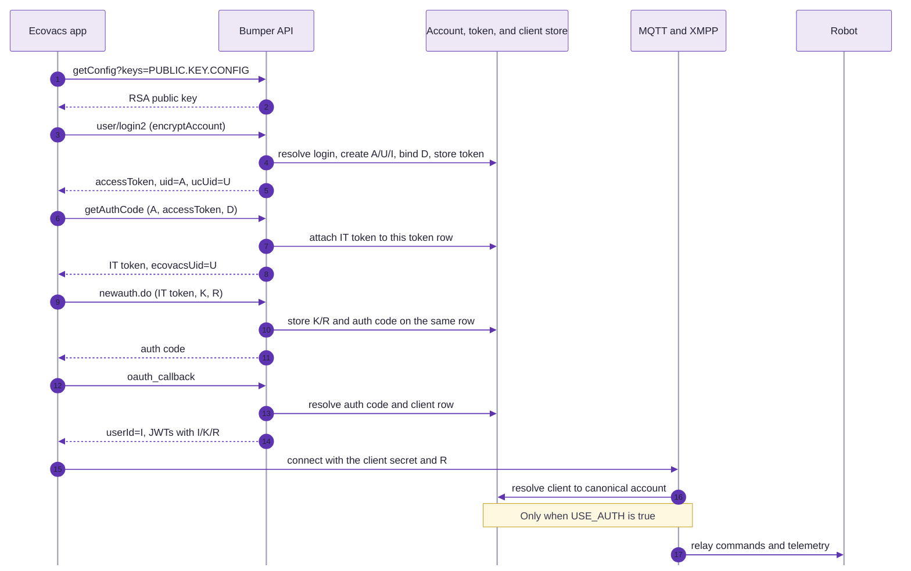

# Authentication

Bumper reproduces the account and token plumbing the Ecovacs app expects, but
it does not reproduce the cloud's security model. The app must work on a LAN
without an Ecovacs account, so Bumper accepts the identity the client names and
issues its own tokens. This page describes both sides: what the official app
does, and what Bumper does with it.

The important consequence is at the top: **HTTP request signatures are not
verified**. JWTs are verified when Bumper uses their claims as proof of account
ownership.

---

## 🔐 Trust model

Bumper is built for a trusted local network. It:

- accepts an account name without checking a password,
- issues an app token for any account name,
- accepts the app's encrypted fields but does not verify who sent them,
- decodes some bearer-token claims for request context without checking the
  signature,
- lets the MQTT and XMPP servers skip token checks because `USE_AUTH` is `False`.

The TLS CA is the real trust boundary. A device that trusts Bumper's CA can
talk to Bumper; Bumper does not establish a second identity for it. Do not
expose the web, MQTT, or XMPP listeners to an untrusted network.

`USE_AUTH` in `bumper/utils/settings.py` is a code constant, not an
environment variable. Setting it to `True` enables secret checks in MQTT and
XMPP. The checks accept a live portal token, auth code, or IT token, or a valid
access JWT signed by this Bumper instance. It does not make the HTTP API verify
request signatures.

---

## 🧩 Identity layers

The account and each app installation have separate identities:

| Identity            | Used by                         | Shape / role                                              |
| ------------------- | ------------------------------- | --------------------------------------------------------- |
| Account id (`A`)    | app and modern API              | `YYYYMMDDHHMMSS_<32 lowercase hex>`                       |
| Unified id (`U`)    | IoT auth-code exchange          | same shape as `A`, generated independently                |
| IoT id (`I`)        | OAuth and legacy transports     | 16 lowercase letters or digits                            |
| Client id (`K`)     | OAuth and app-installation row  | 24 lowercase hex characters                               |
| Resource (`R`)      | XMPP/MQTT connection and client | client-provided resource string                           |
| App device id (`D`) | app path and device ownership   | generated by the app                                      |
| Robot id            | robot, MQTT, XMPP               | serial number or device id, depending on robot generation |

Bumper stores the account in `BumperUser` (`bumper/web/utils/models.py`) and the
short-lived session data in `Token` (`bumper/db/tokens.py`). The user record
carries `A`, `U`, `I`, the login name, aliases, app device ids, and the robots
known to the local service. Each local account receives the shared robot list.
Each token row carries one portal token and its related
IT token, auth code, `K`, `R`, and device id. `ClientRepo` stores the live
connection state for each app client/resource.

### How the user id is made

New accounts receive independent `A`, `U`, and `I` values. `A` is also the
internal `userid` of a newly created account. Existing records keep their
internal id; when first used, Bumper adopts a presented public id into an empty
field or generates a missing id, and retains the old id as an alias. The
pre-redesign 20-character SHA-256-derived id is recognized as a legacy alias,
not generated as the new public account id.

Login resolves the provided name case-insensitively. For `login2`, Bumper
decrypts `encryptAccount` with its local account key and stores the result as
the login name. The encrypted password is accepted but not checked. If no name
is provided, the configured `USER_USERNAME_DEFAULT` is used.

### One account, several names

The app does not use one name for an account. It logs in with a login name,
uses `A` and `U` during the modern flow, and uses `I` for OAuth and legacy
transports. Each app installation also has a device id and client/resource
pair. Bumper keeps one `BumperUser` per account and resolves its public ids and
legacy ids as aliases (`bumper/db/identity.py`). Accounts with different login
names remain separate unless a shared device, presented account id, or valid
token links them.

When a name resolves to a second user record and the link is proven - the
token names one record and the request names the other, or the app device is
bound to one record and the request names the other - the older record wins.
The duplicate's devices, robots, homes, tokens, and clients move to the older
record, and its id becomes an alias. Startup also merges duplicate public ids,
login names, and app-device ownership before reconciling client rows. Rows with
no account owner are removed; rows carrying an account alias are moved to the
canonical account. Distinct client ids or resources remain distinct rows.

`checkLogin` never creates a user. It resolves an unknown name by the app
device and fails if neither is known, because a check is not a registration.
The normal login creates an account when the login name is new, then binds the
device to it. Reusing the same login name resolves to the same account.

---

## 🌐 The official flow

The current app uses two API families at once. The account screens and the
login handshake use the modern `*.ecovacs.com` API. The robot-facing calls and
the OAuth exchange use the legacy `*.ecouser.net` API.



### 1. The app reads the account key

The app asks the modern API for configuration:

```text
GET /v1/private/{country}/{language}/{deviceId}/{appType}/{version}/{deviceType}/{aid}/common/getConfig?keys=PUBLIC.KEY.CONFIG
```

The answer contains the RSA public key as base64 DER. The app uses it to
encrypt fields such as `encryptAccount`, `encryptPwd`, `encryptEmail`, and the
backup address before they leave the phone. The private key never leaves the
server.

Bumper serves the public half at the same path. The key is generated once and
stored in `BUMPER_ACCOUNT_KEY` (default `${BUMPER_DATA}/account.key`) with mode
`0600`. It is separate from the TLS server key on purpose: the app needs RSA,
the default TLS key is EC, and rotating the TLS certificate must not rotate the
account key.

### 2. The app logs in

The modern login path is:

```text
GET /v2/private/{country}/{language}/{deviceId}/{appType}/{version}/{deviceType}/{aid}/user/login2
```

The request carries `encryptAccount` and `encryptPwd`, plus the signing query
parameters described below. Bumper decrypts the account name, resolves or
creates one account, binds the app device id, and issues a portal token. The
answer contains `accessToken`, `uid` (`A`), `ucUid` (`U`), `loginName`,
`username`, `country`, and the response fields expected by the app.

If the account is new, the cloud may answer with `loginResult: HIGH_RISK` and
`loginRiskScene: NEW_DEVICE`, and the app asks for an email code before it
continues. Bumper answers success directly.

### 3. The app exchanges the account token for an IoT token

The app calls the OpenAPI host:

```text
GET /v1/global/auth/getAuthCode?uid={uid}&accessToken={token}&bizType=ECOVACS_IOT&deviceId={deviceId}
```

The answer is an IT token:

```json
{
    "code": "0000",
    "data": {
        "authCode": "GLOBAL_APP_ECOVACS_IOT_<32 hex>",
        "ecovacsUid": "<user id>"
    }
}
```

Despite the field name, this `authCode` is the IT token. It is attached to the
token row identified by the presented access token. The app then posts it
to the legacy login:

```text
POST /newauth.do
{"todo": "OLoginByITToken", "itToken": "GLOBAL_APP_ECOVACS_IOT_<32 hex>"}
```

The answer is the real auth code:

```json
{ "todo": "result", "result": "ok", "authCode": "<32 hex>" }
```

### 4. The app gets OAuth tokens

The auth code is exchanged on the legacy API:

```text
GET /api/appsvr/oauth_callback?state={"cid":"<client id>"}&code={authCode}
```

The answer carries `userId` (`I`), `access_token`, `refresh_token`, and
`expire_at` in milliseconds. The access token is a JWT. Its claims name the
client (`c` = `K`), the user (`u` = `I`), the client resource (`r` = `R`), and
the auth code (`ac`).

The app refreshes the pair through:

```text
GET /api/appsvr/oauth/token?grant_type=refresh_token&refresh_token={jwt}&client_id={client id}
```

The refresh token is the same kind of JWT with `t: "r"`; the access token has
`t: "a"`.

### 5. Later calls

The modern API sends the access token as `accessToken` in the query string and
also as `authorization: Bearer <jwt>` on some calls. The legacy API sends the
opaque token as `token` or `accessToken`, depending on the endpoint.

The MQTT and XMPP transports resolve the presented IoT name and secret to the
canonical account. With `USE_AUTH=True`, an access JWT must be signed by this
Bumper instance. Connection rows retain their client/resource identity, so
parallel app installations do not overwrite one another.

---

## ✍️ Signing on the modern API

The modern API adds five query parameters to every call:

| Parameter      | Meaning                                                                |
| -------------- | ---------------------------------------------------------------------- |
| `authAppkey`   | The app key. The app ships several, for the app and for OpenAPI.       |
| `authTimespan` | The app clock in milliseconds, plus the server offset.                 |
| `authTimeZone` | The device timezone, for example `GMT+2`.                              |
| `requestId`    | A per-request random id.                                               |
| `authSign`     | A digest over the app key, the sorted parameters, and a native secret. |

The reference implementation builds the canonical string from the app key and
the sorted query parameters, appends the secret, and digests the result. The
keys and secrets are resolved from the native `libeco-network.so` library, not
from Java constants.

Bumper ignores all five parameters. It does not reject a missing, stale, or
wrong `authSign`. This is intentional for a LAN server: the app must
work with a clock that is not synchronized to Ecovacs, and the signature
protects a cloud account Bumper does not have.

The legacy API has a parallel scheme. `com.ecovacs.lib_iot_client` sends
`appid`, `ts`, and `sign`, where `sign` is `SHA1(appid + APP_SECRET + ts)`.
Bumper does not verify those either. The app ships several app ids and secrets
for the `ecovacs` and `yeedi` brands; Bumper does not need them.

---

## 🛠️ What Bumper implements

### Login and tokens

`bumper/web/auth_service.py:login` serves both `user/login` and
`user/checkLogin` on v1 and v2. The behavior is:

1. Decrypt `encryptAccount` when present, then resolve the login name.
2. Create an account with `A`, `U`, and `I` when the login name is new.
3. Bind the app device id to that account.
4. Remove expired token rows for the account.
5. Generate a fresh opaque portal token and store a row for this login.
6. Return `uid=A` and `ucUid=U` in the login document.

`checkLogin` never creates a user. An unknown name is resolved by the app
device, and a request that matches neither is rejected. A check with a valid
`accessToken` returns the same token. A check without a token issues a new one
for the known account; an invalid supplied token is rejected. The portal token
is opaque; it is not a JWT.

The portal-token lifetime is `TOKEN_VALIDITY_SECONDS` (30 days). Expiry removes
the token row, including its IT token and auth code. A check with an expired
portal token fails rather than silently replacing it. The modern
`/v1/global/auth/getAuthCode` path requires a live portal token.

### GetAuthCode

There are two paths:

- `/v1/global/auth/getAuthCode` and the private `getAuthCode` endpoint return
  the IT token in `authCode`. A live access token is required, and the IT token
  is attached to the token row that access token identifies.
- `api/users/user.do` with `todo: GetAuthCode` returns the legacy auth code in
  `code`. It uses the token row named by the request when possible, or creates
  a portal-token row when no row is available.

Both paths resolve the presented account names to one user. A JWT claim is
used to link accounts only after `verify_jwt` checks the signature, expiry, and
access-token type. The IT token and auth code remain attached to the same
client token row, so the next exchanges preserve the client boundary.

### newauth.do

`bumper/web/single_paths.py:handle_new_auth` accepts only
`todo: OLoginByITToken`. It calls `get_new_auth`, which looks up the IT token,
rejects an expired row, and returns the existing or newly generated auth code.
The request's `clientID` and `resource` are stored on that same token and
client row.
The response is bound to the `AUTH` shape, so the answer is
`{"todo": "result", "result": "ok", "authCode": "..."}`.

`loginByItToken` on `api/users/user.do` answers with `userId=I`, the portal
token from the matching client row, and `last`, its remaining lifetime in
milliseconds. The IT token is only the input of the exchange.

### OAuth and JWT

`oauth_callback` resolves the auth code to its token row, reads that row's
client id and resource, and generates two JWTs with `generate_jwt_helper`:

- access token: `t: "a"`, expiry `ACCESS_TOKEN_VALIDITY_SECONDS` (30 minutes)
- refresh token: `t: "r"`, expiry `REFRESH_TOKEN_VALIDITY_SECONDS` (30 days)

The token row remains until the refresh token expires. A successful OAuth
exchange moves its expiry to the refresh token's expiry, and each successful
refresh extends the session. This lets the app resume after an idle period
without keeping the access JWT long-lived. Logout removes the row and revokes
the refresh session.

The tokens are signed with the TLS server key (`bumper_isc.server_key`) and the
algorithm in `TOKEN_JWT_ALG`. The default follows the certificate key type:
`ES256` for EC and `RS256` for RSA.

`bumper/web/jwt.py` has two readers. `get_jwt_details` and
`extract_jwt_details` decode the claims without checking the signature for the
request context. `verify_jwt` loads the public key from the TLS certificate,
checks the signature, the expiry, and the token type, and is the only reader
that may be used as proof. The legacy `GetAuthCode` call, the refresh grant, and
transport authentication use `verify_jwt`; a refresh token is not accepted
where an access token is required. Account resolution also uses a JWT only
after this check, even when `USE_AUTH` is off, because the claim can move a
name between accounts.

### The account key

`bumper/utils/account_key.py` owns the RSA key used for encrypted account
fields:

- `account_public_key()` returns base64 DER, which is what
  `PUBLIC.KEY.CONFIG` serves.
- `decrypt_account_field()` decodes base64, decrypts with PKCS#1 v1.5, and
  returns the stripped UTF-8 text, or `None` on a malformed or foreign value.
- `_load_or_create()` generates a 2048-bit RSA key on first use, writes it with
  `O_EXCL` at mode `0600`, and re-reads it if another process won the race.

The private key is not used to sign JWTs or TLS certificates. It only decrypts
the fields the app encrypts with the public key.

If the key changes, the app keeps the old public key for the life of its
process. Force-stop the app after replacing `account.key`; otherwise the next
email or password change returns `1008` because the ciphertext cannot be
decrypted.

### Email, password, and OTP

| Endpoint                       | Behavior                                                             |
| ------------------------------ | -------------------------------------------------------------------- |
| `user/sendEmailVerifyCode`     | Returns a fresh `verifyId` UUID. No mail is sent.                    |
| `user/checkEmailVerifyByScene` | Accepts `EMAIL_VERIFY_CODE` (default `666666`).                      |
| `user/bindEmail2`              | Checks `verifyCode`, decrypts `encryptEmail`, stores it as `email`.  |
| `user/addBackupEmail`          | Decrypts `encryptEmail` and stores it as `backup_email`.             |
| `user/modifyPassword`          | Returns success with `data: null`. The password is not stored.       |
| `device/otp/generate`          | Returns a six digit code and stores it for `DEVICE_OTP_TTL_SECONDS`. |
| `device/verify/check`          | Accepts the code while it is in the TTL.                             |

`bindEmail2` and `addBackupEmail` use `claimed_userid`, which reads `userid`,
`uid`, a `userid` header, or the `auth` query object. None of those is signed.
The address is stored only, not verified against a mailbox.

The OTP flow is equally local: the code is generated, returned to the caller,
and accepted for the TTL. It is not a security control against a LAN peer.

### Robot transports

The app reaches the robot through XMPP or MQTT, depending on the model.

**XMPP** (`bumper/xmpp/xmpp.py`)

- The app and the robot connect over TLS on port `5223`.
- SASL PLAIN carries an authzid, the user id, and a password. The password is
  either a bare secret or `0/<resource>/<secret>`. Bumper reads the user id and
  the resource from the NUL-separated payload and joins the rest of the
  password after the resource, because a JWT never contains `/`.
- A client with a `devclass` is a robot: Bumper stores it as a bot and accepts
  it without a token check.
- A client without a `devclass` is the app. Bumper resolves the name through
  the portal token, the auth code, the IT token, or a signed access JWT to the
  canonical account and records the client under that account and resource.
  With `USE_AUTH=True` the secret must verify with
  `identity.verify_transport_secret`; with `USE_AUTH=False` the client is
  accepted and a name is adopted only when it already resolves or a valid
  secret links it.
- The bound JID is `<uid>@<devclass>.ecorobot.net/atom` for a robot and
  `<uid>@<server>/<resource>` for the app.

**MQTT** (`bumper/mqtt/server.py`)

- The broker listens on `1883` (plain) and `8883` (TLS).
- A client id has the form `<did>@<class id>/<resource>`.
- The class id decides the side: `USER_CLASS_IDS` (`ecouser`, `bumper`,
  `USER`) means app, anything else means robot.
- The username may carry base64 app headers after a backtick; Bumper decodes
  them for logging and keeps the first segment as the username.
- The helper bot uses a fixed client id and is accepted before any other check.
- Bumper resolves the presented client name to the canonical account before it
  stores the client. Each client id/resource has its own row, so one account
  can keep parallel app installations and transport connections.
- With `USE_AUTH=False`, Bumper accepts the password as-is. With
  `USE_AUTH=True`, the password must be a portal token, an auth code, an IT
  token, or a signed access JWT issued for that account.
- A password file can also hold `username:hash` entries for broker users. It is
  read from `${BUMPER_DATA}/passwd`.

The helper bot is Bumper's own client. It connects to the broker with the fixed
`HELPER_BOT_CLIENT_ID`, bypasses authentication, and is the only component that
writes the firmware version it learns from a robot into the database.

---

## 📱 The app on the wire

These facts come from the app package and are useful when a login fails:

- The legacy client is `com.ecovacs.lib_iot_client`; it builds `appid`, `ts`,
  and `sign` in `NetRequestUtil`.
- The modern client is `com.eco.econetwork`; `SigningInterceptor` and
  `OpenSigningInterceptor` add `authAppkey`, `authTimespan`, `authTimeZone`,
  `requestId`, and `authSign`.
- The app reads `PUBLIC.KEY.CONFIG` before it encrypts account fields.
- The app pins no certificate except the MQTT broker. The MQTT pin is embedded
  in a `classes*.dex`; `scripts/app/apk-patch/patch-mqtt-trust.py` removes it so
  Paho falls back to the platform store.
- The NGIoT channel uses a native mbedTLS stack. It reads the system CA store
  and ignores the user store, so a user-installed Bumper CA does not cover it.
  If only that channel fails, suspect this before the certificate names.
- The app's account screens need React Native and Hermes. A white screen there
  is usually a missing `libhermes.so` for the emulator ABI, not a Bumper auth
  failure.

The app package is the source for these details.

---

## 🤖 The robot on the wire

The robot does not log in with an Ecovacs account. It is provisioned with the
server address and a local identity, and then it connects:

- Older robots use XMPP with the serial number as the user id and `atom` as
  the resource.
- Newer robots use MQTT with the serial number or device id as the client id,
  the model as the class id, and a resource name.
- The auth code is the link from the account login to the transport. The robot
  receives it through the app's provisioning step, not through the cloud login.
- TLS is verified against the CA the robot trusts. That CA is the one Bumper
  serves at `/ca-certificates.tar.gz`.

When Bumper sees a robot for the first time, the MQTT or XMPP login creates the
bot record. Later calls use that record to resolve the serial number, model,
and resource.

---

## 🗺️ Code map

| Concern                   | File                                        |
| ------------------------- | ------------------------------------------- |
| Login, tokens, auth codes | `bumper/web/auth_service.py`                |
| JWT decoding and checking | `bumper/web/jwt.py`                         |
| Request identity helpers  | `bumper/web/context.py`                     |
| Account names and aliases | `bumper/db/identity.py`                     |
| Public account id shapes  | `bumper/utils/account_ids.py`               |
| Token and user records    | `bumper/db/tokens.py`, `bumper/db/users.py` |
| Client records            | `bumper/db/clients.py`                      |
| Account RSA key           | `bumper/utils/account_key.py`               |
| Auth endpoints (v1)       | `bumper/web/plugins/v1/private/user.py`     |
| Auth endpoints (v2)       | `bumper/web/plugins/v2/private/user.py`     |
| OpenAPI auth code         | `bumper/web/plugins/v1/global_auth.py`      |
| newauth.do                | `bumper/web/single_paths.py`                |
| OAuth callback            | `bumper/web/plugins/api/appsvr.py`          |
| XMPP authentication       | `bumper/xmpp/xmpp.py`                       |
| MQTT authentication       | `bumper/mqtt/server.py`                     |
| OTP endpoints             | `bumper/web/plugins/v1/private/device.py`   |

---

## ⚠️ Known gaps

- `authSign` is not verified. A wrong signature is accepted.
- `appid`, `ts`, and the legacy `sign` are not verified.
- The account password is ignored. Any password logs in.
- Some request-context helpers decode JWT claims without checking the
  signature. Account linking and transport authentication use `verify_jwt`,
  which checks the signature, expiry, and token type.
- `USE_AUTH` is a code constant, not an environment setting.
- The auth code and IT token are removed when their portal/refresh session row
  expires. The legacy `GetAuthCode` path can create a fresh row; modern
  `getAuthCode` requires a live portal token and the client must log in again.
- A logout with a recognized token revokes only its client row. A logout with
  no token revokes every token and client for the account; an unknown supplied
  token does not log out unrelated clients.
- The email verification code is fixed. Bumper never sends mail.
- The OTP is returned to the caller and accepted for its TTL. It is a UX
  emulation, not a second factor.

These are deliberate for a self-hosted LAN replacement. Treat the network and
the CA as the security boundary, not the application tokens.
